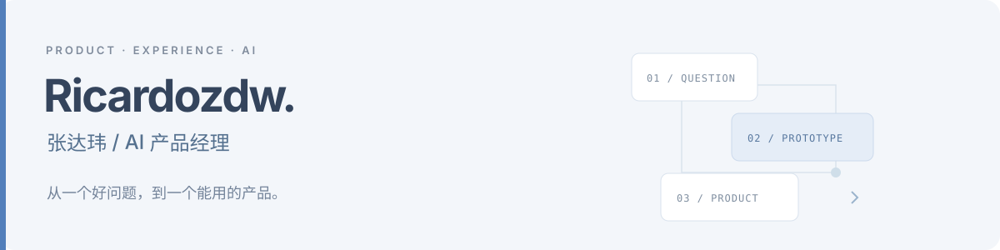

  

# 你好，我是张达玮

**AI 产品经理，关注产品拆解、知识库与 Agent 工作流。**

我喜欢从真实的问题出发，把需求、体验与技术连接起来，再用原型和可运行的项目验证想法。

`AI 产品经理` `产品拆解` `RAG / 企业知识库` `Agent Skills` `交互原型` `内容工作流`

[个人网站](https://ricardozdw.github.io/) · [全部仓库](https://github.com/Ricardozdw?tab=repositories) · [项目与作品](#项目与作品) · [技能与实践](#技能与实践) · [文章与报告](#文章与报告)

## 项目与作品

| 项目 | 内容与解决的问题 | 项目形态 | 入口 |
| --- | --- | --- | --- |
| **[知汇台](https://github.com/Ricardozdw/zhihuitai)** | 企业知识库中台，串联知识导入、引用式问答、可观测与评测回流。 | React / TypeScript / Ant Design；仓库包含 FastAPI 后端。在线页面为 **Mock 前端演示**。 | [在线演示](https://ricardozdw.github.io/zhihuitai/) · [源码](https://github.com/Ricardozdw/zhihuitai) |
| **[小红书成稿工坊](https://github.com/Ricardozdw/xiaohongshu-content-studio)** | 将链接或材料按「内容整理 → 确认改写 → 图文制作」组织成稿件、图文与发布素材。 | 可安装的 Agent Skill，附五种版式预览与浏览器转写工具。 | [项目介绍](https://ricardozdw.github.io/xiaohongshu-content-studio/) · [版式预览](https://ricardozdw.github.io/xiaohongshu-content-studio/styles.html) · [源码](https://github.com/Ricardozdw/xiaohongshu-content-studio) |
| **[AI 产品拆解 Skill](https://github.com/Ricardozdw/ai-product-teardown)** | 以「五问五层」梳理用户场景、人机分工、模型、成本与壁垒，形成有证据来源的产品分析。 | Agent Skill；支持飞书文档、Markdown 与 HTML 报告。 | [项目介绍](https://ricardozdw.github.io/ai-product-teardown/) · [通义听悟示例](https://ricardozdw.github.io/ai-product-teardown/examples-tingwu-teardown.html) · [源码](https://github.com/Ricardozdw/ai-product-teardown) |
| **[Behance Landing / Showcase](https://github.com/Ricardozdw/behance-landing)** | 视觉交互实验：可拖拽的鱼眼网格、水波反馈、项目画廊与沉浸式详情切换。 | React / TypeScript / Three.js / GSAP。 | [在线预览](https://ricardozdw.github.io/behance-landing/) · [源码](https://github.com/Ricardozdw/behance-landing) |
| **[个人网站](https://github.com/Ricardozdw/ricardozdw.github.io)** | 个人介绍、项目作品与产品思考的展示空间。 | HTML / CSS / JavaScript；GitHub Actions 自动部署到 GitHub Pages。 | [访问网站](https://ricardozdw.github.io/) · [源码](https://github.com/Ricardozdw/ricardozdw.github.io) |

## 技能与实践

### 产品能力

| 方向 | 实践内容 |
| --- | --- |
| **AI 产品分析** | 需求场景、用户旅程、五问五层拆解、证据核验与二次验证。 |
| **知识库与 AI 应用** | RAG、知识导入、引用式问答、可观测、Case 回流与评测流程。 |
| **Agent 工作流** | Skill 设计、分阶段确认、内容整理、文档与图文交付。 |
| **产品原型与体验** | 多角色工作台、信息架构、人机协作界面、交互与视觉原型。 |

### 项目实践中的技术

**前端与交互**  
`React` `TypeScript` `JavaScript` `HTML / CSS` `Ant Design` `Three.js` `GSAP` `Vite`

**后端与知识库**  
`Python` `FastAPI` `PostgreSQL / pgvector` `Redis / Celery` `Docker`

**构建与交付**  
`Git / GitHub` `GitHub Actions` `GitHub Pages` `Markdown` `HTML 报告`

## 文章与报告

<!-- ARTICLES:START -->
### 持续写作

| 平台 | 内容入口 |
| --- | --- |
| **小红书** | [我的小红书主页与全部笔记](https://www.xiaohongshu.com/user/profile/5fc6c032000000000101e057) |
| **微信公众号** | 在微信搜索公众号 ID：`zdw_7520269` |

### 产品拆解

- **[以通义听悟为例，拆解一个音视频智能纪要产品](https://ricardozdw.github.io/ai-product-teardown/examples-tingwu-teardown.html)**  
  从使用场景、用户层、技术层、模型层到基础层组织分析，并保留证据标签与二次验证清单。
<!-- ARTICLES:END -->

---

我关注的是：**从问题出发，在构建中思考，让复杂回归简单。**

[访问我的个人网站](https://ricardozdw.github.io/) · [查看 GitHub 项目](https://github.com/Ricardozdw?tab=repositories)
